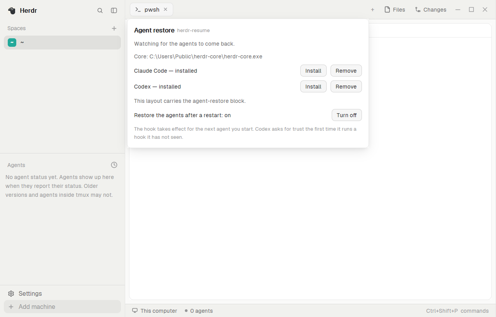

# Agent restore

Herdr's kept terminals come back after a restart as plain shells — the agent that was in them is gone, because the core never runs a kept terminal's program again. This mod puts the agent back: it watches the terminals Herdr recovered, finds the ones whose agent reported its session, and types that agent's resume command into the shell, so Claude Code and Codex come back with the conversation they had, in the same pane. Its own panel is a popup at the top of the window that says what it would do: whether Herdr's own restore is on and the mod standing down, which core the hook would report through, whether the hook is installed for Claude Code and for Codex, whether the layout you are in carries the block that runs the restore, and whether the restore itself is switched on.

**Install:** tell your Herdr agent "Install the Herdr mod at
https://github.com/cifilaci/herdr-mods/tree/main/agent-restore". No key is shipped for it; bind one
yourself in `~/.config/herdr-app/keys.json` — `"ctrl-shift-r": "mod.open:agent-restore"` in the
`global` section — or open the panel with `herdr-app do mod.open '{"name":"agent-restore"}'`. It needs
`herdr-core` on the PATH (or named in Herdr's settings) and the agents already installed. Before you
install: the mod runs programs (`hc`, `sh` or `powershell`) and reads and writes files outside its
own folder — the app home's `settings.json` and `programs.json`, your Claude config dir
(`CLAUDE_CONFIG_DIR` when it is set, else `~/.claude`) and your Codex home (`CODEX_HOME` when it is
set, else `~/.codex`). It does not reach the network. What the agent does:

1. Copy the mod's own files — `main.js`, `decide.js`, `install.js`, `hook.js` and `mod.json`, from
   `agent-restore/mods/agent-restore/` — into Herdr's mods folder
   (`~/.config/herdr-app/mods/` on Linux and macOS, `%USERPROFILE%\.config\herdr-app\mods\`
   on Windows), leaving `RECIPE.md` and `preview.png` out, they are the brief and the picture and
   not part of the mod, then run `herdr-app check ~/.config/herdr-app/mods/agent-restore`.
2. Give the mod a block in a personal layout. A shipped layout is read-only and replaced on every
   start, so the block goes in a clone: `herdr-app do layout.clone '{"name":"main","as":"my-layout"}'`
   clones the layout you boot into (it switches to the clone, which looks and works the same; tell
   the person a clone does not get Herdr's later changes to `main`), then in
   `layouts/my-layout.json` add to the clone's root
   `{"id": "agent-restore", "type": "block", "size": {"px": 0}, "content": {"mod": "agent-restore"}}`
   and run `herdr-app do layout.switch '{"name":"my-layout"}'`. The block takes no room. The restore
   runs in the layout that carries the block, so the clone is the one that matters after a reboot.
3. Open the panel and press **Install** for Claude Code and for Codex. That writes
   `~/.claude/skills/herdr-resume/` for Claude Code and the mod's own entries in
   `~/.codex/hooks.json` for Codex, and touches no other file of yours. The hook takes effect for
   the next agent you start, so start one after installing.

## What you see

Two copies of one file, and they look nothing alike.

**The block** — the copy in the layout — draws nothing. Its `render()` returns an empty div, so the
zero-height block is empty: no header, no border, no background. The only thing it puts on screen
is the toasts it posts.

**The panel** — the copy `mod.open` opens — is a popup: 520 px wide, 70 % of the window's height, its
top edge 40 px below the top of the window, on the theme's `popover` background with 14 px padding
and 8 px gaps; the root sets no text size of its own — each line below sets its own (13, 12 or
11 px). Top to bottom:

- **Header row.** "Agent restore" (13 px semibold, `foreground`) and beside it "herdr-resume"
  (11 px, `dim`).
- **Status line** (12 px, `muted`) — where the mod stands, one of three:
  "Herdr's own agent restore is on — the mod stands down." /
  "Herdr's own agent restore is off — the mod takes over." /
  "Watching for the agents to come back."
- **Core line** (12 px) — "Looking for the core…" (`dim`) while it looks; in the theme's `blocked`
  colour "No herdr-core was found — the hook cannot report." when there is none; otherwise
  "Core: /path/to/herdr-core" (`muted`).
- **Claude Code line** (12 px, `foreground`) — "Claude Code — installed" or
  "Claude Code — not installed", then the buttons **Install** and **Remove**.
- **Codex line** (12 px, `foreground`) — "Codex — installed" or "Codex — not installed", then
  **Install** and **Remove**.
- **Layout line** (12 px, `muted`) — "Looking at the layout…" (`dim`) while it looks; then
  "This layout carries the agent-restore block." or
  "This layout has no agent-restore block — add one to your layout, or the mod will not run."
- **Switch line** — "Restore the agents after a restart: on" or
  "Restore the agents after a restart: off" (12 px, `foreground`) and a **Turn off** / **Turn on**
  button.
- **Last restored line** (12 px, `dim`) — only after something was restored:
  "Last restored: Claude Code in t3, at 14:32." The address is the terminal's, the time is the
  person's own clock (HH:MM).
- **Hint line** (11 px, `dim`) — "The hook takes effect for the next agent you start. Codex asks for
  trust the first time it runs a hook it has not seen."

A button is 26 px tall, 10 px of padding left and right, 7 px corners, a 1 px `input` border, a
`raised` background, `foreground` text at 12 px; the pointer over it takes the `hover` background.

## How it behaves

- **Two copies, one file.** The copy whose `props()` carries an `overlay` is the panel; the copy in
  the layout block is the worker. The panel never resumes anything; the worker never draws.
- **The worker looks every two seconds.** It reads the terminals and asks one pure question per
  terminal; it never redraws (Herdr redraws the mods by itself when the live data changes).
- **Which terminals may be resumed.** A terminal is a candidate only when all of these hold, in
  this order:
  1. it carries a label `herdr.resume.<agent>` whose value is JSON with a non-empty `session_id` —
     otherwise **no session reference**;
  2. it is in a pane of a space Herdr knows — otherwise **it has no pane**;
  3. that space is on this computer — otherwise **it is on another machine**, or, when Herdr does
     not list the space at all, **Herdr does not know its space**;
  4. it was not started during this run — otherwise **Herdr started it**;
  5. its program is a shell — otherwise **it is not a shell** (the agent is still running);
  6. the mod knows a resume command for that agent — otherwise **Herdr cannot resume that agent**;
  7. the command passes the argv rules — otherwise **the resume command is not allowed** (the first
     word is a plain command name with no path and no metacharacter, at most 64 arguments and 8 KiB
     in all, no argument holding an apostrophe or a control character);
  8. the shell is one the mod writes syntax for — otherwise **Herdr cannot write a command for that
     shell** (cmd, nushell and elvish are refused, not guessed at).
- **Five of those reasons are said out loud**, in a toast, once per terminal and reason: "it is on
  another machine", "Herdr does not know its space", "Herdr cannot resume that agent", "the resume
  command is not allowed", "Herdr cannot write a command for that shell". The toast reads
  "<Agent> was not resumed" and "<reason> — the pane stays a shell". The other four — no reference,
  no pane, Herdr started it, not a shell — are silent: they are ordinary, and they would fire on
  every terminal every two seconds.
- **The rule that says a restart happened.** The mod resumes a terminal only when the running core
  recovered it. The core's start time is asked of the core itself: `hc server status --json`, read
  as `uptime_ms` (or `core.uptime_ms`), which gives `now - uptime_ms`. The terminal's own record
  carries the `created_ms` it always had — a recovered terminal keeps it, a terminal the running
  core created is newer than the core. So the core recovered the terminal exactly when the core's
  start time is later than the terminal's `created_ms`. A core that cannot be asked has no start
  time, and no evidence is never a restart. A terminal whose agent merely died (a crash, a
  `kill -9`) was created by the core that is still running, so it is newer: the pane stays a plain
  shell, and nothing is typed.
- **The settle.** Before anything is typed the mod waits three seconds — the core's own quiet
  period — and reads the terminal again. A terminal the person closed is left alone; a terminal
  where an agent is running now is left alone.
- **The command.** `claude --resume <session>` for Claude Code, `codex --no-daemon resume <session>`
  for Codex, unless the person's own `programs.json` says otherwise for that agent — their line
  wins, the mod's own table fills the rest. It is written for the shell the terminal is really
  running: in a POSIX shell `'claude' '--resume' 'abc123'`, in PowerShell
  `& 'claude' '--resume' 'abc123'`. The core pastes it and presses Enter (`hc send <address>
  <command>`).
- **Toasts.** "Sent the resume command for Claude Code" (body: "the resume command was sent").
  If the agent has not reported itself within fifteen seconds: "Claude Code did not start" (body:
  "the resume command was sent, but the agent never reported"). If the core refused the send:
  "Not resumed" (body: "Claude Code: <what the core said>"). Nothing is ever retried; the person
  decides.
- **Herdr's own restore.** If this build of Herdr has the feature (its command list holds
  `agent.integration`) and the app home's `settings.json` does not set
  `resume_agents_on_restore` to `false`, Herdr resumes the agents itself and the mod stands down:
  a toast says "Herdr's own agent restore is on" / "Herdr's own agent restore is installed on this
  build — the mod stands down.", and the panel's status line says so. With the setting `false` the
  mod takes over ("The mod takes over" / "Herdr's own agent restore is off — the mod takes over.").
  On a build with no such command the status line reads "Watching for the agents to come back." and
  the mod is the only restore. The mod reads the app home's `settings.json`; it never writes it.
- **The switch.** **Turn off** stops the restore and says "The restore is off" / "the mod resumes
  nothing"; **Turn on** says "The restore is on" / "the mod resumes the agents after a restart".
  The switch lives in the mods' shared storage, so both copies obey it, and while it is off the
  worker resumes nothing; a resume that was already sent can still report that the agent never came
  back.
- **Install.** Pressing **Install** beside Claude Code writes the hook script to the app home
  (`<app home>/integrations/herdr.resume.claude/herdr-resume.sh`, or `.ps1` on Windows) and writes
  `~/.claude/skills/herdr-resume/.claude-plugin/plugin.json` (name "herdr-resume", version "1")
  and `~/.claude/skills/herdr-resume/hooks/hooks.json` (a SessionStart and a SessionEnd hook, 10 s
  timeout each) — under `CLAUDE_CONFIG_DIR` when it is set. Pressing **Install** beside Codex writes
  the same script under `<app home>/integrations/herdr.resume.codex/` and merges the mod's own entry
  into `~/.codex/hooks.json` (SessionStart runs the script with "session", SessionEnd with "end", 10 s
  timeout) — under `CODEX_HOME` when it is set. Your own hooks in that file stay; a second install
  replaces the mod's entry instead of adding another. The toast says "Installed the hook for Claude
  Code" / "the hook takes effect for the next agent you start". With no core to report through it
  refuses: "No herdr-core found" / "Claude Code: the hook needs the core binary — put herdr-core on
  the PATH, or name it in Herdr's settings." A file it cannot write: "Not installed" /
  "Claude Code: the file was not written — <why>". A Codex hooks file that is not valid JSON:
  "Not installed" / "Codex: the hooks file is not valid JSON — it was not changed."
- **Remove** takes away only the mod's own: the mod's entry in `~/.codex/hooks.json`, the mod's own
  folder `<app home>/integrations/herdr.resume.<agent>/`, and for Claude Code
  `~/.claude/skills/herdr-resume/`. Nothing else of yours is touched. The toast says
  "Removed the hook for Claude Code" / "the agent will not report its session any more", or
  "Nothing to remove for Claude Code" / "there was nothing of the mod's own there", or
  "Not fully removed" with the reasons.
- **The hook itself.** It is a small script the agent runs at SessionStart: it reads the payload
  from stdin and labels the terminal it runs in with `herdr.resume.claude={"session_id":"…"}`; at
  SessionEnd it clears that label, so a session you ended is not resumed later. Outside Herdr (no
  `HC_TERMINAL_ID`) it does nothing at all. It swallows its own errors, which is why the panel
  shows the core's path: a wrong path means the agent never reports and nothing would say so.
- **Keys.** The mod answers no `nextCommand()`; the only way in is `mod.open:agent-restore`. A key
  bound to `agent-restore.<anything>` does nothing.

## Built from

- **Files.** `main.js` (the worker and the panel), `decide.js` (the pure decision: the labels in,
  "resume this" or "skip, and why" out), `install.js` (the pure installer: the hook command, the
  Claude plugin's two files, the Codex merge and removal, the core's candidate paths), `hook.js`
  (the two hook scripts, as text), `mod.json`. The mod's own folder holds nothing else — the
  published folder also carries the `RECIPE.md` and the `preview.png`, which are not part of the mod.
- **`mod.json`**:
  `{ "place": "none", "title": "Agent restore", "overlay": { "kind": "popup", "at": "top", "offset": 40, "width": 520, "height": 0.7 } }`
  The overlay block is where the size comes from — the view does not set it. `"place": "none"` means
  the app never docks the mod by itself; the block in the layout is what puts it there.
- **The imports**, each on one line:
  `import { View, div } from "gpui-kit";`
  `import { v_flex, h_flex } from "gpui-base";`
  `import { props, terminals, panes, spaces, hc, exec, notify, shared, setShared, settings, commands, theme, appHome, home, layout, window, readTextFile, writeTextFile } from "herdr";`
  `import { factsFor, decide, recoveredByCore, personResumeTable, reference, awaiting, AGENT_NAMES, LABEL_PREFIX } from "./decide.js";`
  `import { scriptText } from "./hook.js";`
  `import { claudePluginFiles, mergeCodexHooks, stripCodexHooks, isHerdrHook, coreCandidates, psPath } from "./install.js";`
  `decide.js` imports nothing at all; `install.js` and `hook.js` import only `LABEL_PREFIX` from
  `./decide.js`; none of the three imports `gpui-kit` or `herdr`, so the rules can be run by bun
  without Herdr.
- **The herdr module it uses.** `props` (only `props().overlay`, to tell the two copies apart),
  `terminals` (every core terminal: its address, its labels, its program, its `created_ms`), `panes`
  and `spaces` (to find the space a pane is on), `hc` (the core's own CLI), `exec` (the programs
  below), `notify` (the toasts), `shared` / `setShared` (the mod's own state, keyed
  `"agent-restore"`), `settings` (only as a fallback, see Watch out), `commands` (to learn whether
  this build has Herdr's own agent restore), `theme` (every colour by name), `appHome` and `home`
  (the paths), `layout` (to see whether the shown layout carries the block), `window` (only
  `platform`, to pick PowerShell or `sh`), `readTextFile` and `writeTextFile` (the settings, the
  programs table, the hook script and the agents' registration).
- **Commands.** `mod.open:agent-restore` opens the panel; `layout.clone` and `layout.switch` are
  what the person runs for the block (`herdr-app do layout.clone '{"name":"main","as":"my-layout"}'`,
  `herdr-app do layout.switch '{"name":"my-layout"}'`).
- **Programs it runs**:
  - `hc server status --json`, through `hc([...])` — the core's uptime, and from it the core's
    start time. It is not a pure read: it starts the session's core if none is running.
  - `hc send <address> <command>`, through `hc([...])` — the core pastes the resume command and
    presses Enter.
  - `<core> --version`, through `exec` — the app's own test for a core: the version it prints
    starts with "hc ".
  - `sh -c 'printf %s "$VAR"'` or `powershell.exe -NoProfile -Command $env:VAR`, through `exec` —
    to read `CLAUDE_CONFIG_DIR`, `CODEX_HOME`, `HERDR_CORE_DIRS`, `PATH` and `LOCALAPPDATA`; the
    mod API has no `process.env`.
  - `rm -rf <folder>` or `powershell.exe -NoProfile -Command Remove-Item -LiteralPath '<folder>'
    -Recurse -Force`, through `exec` — the mod API has no delete. The PowerShell path is quoted
    inside the command string, because `powershell.exe` re-joins its arguments with spaces.
- **Its constants.** `POLL_MS = 2000`, `SETTLE_MS = 3000`, `READ_TTL_MS = 5000`,
  `REPORT_WAIT_MS = 15000` (in `decide.js`), `MAX_ARGS = 64` and `MAX_BYTES = 8 * 1024` (in
  `decide.js`), `POSIX_SHELLS = ["sh", "bash", "zsh", "dash", "ksh", "fish"]` and
  `POWERSHELL_SHELLS = ["pwsh", "powershell"]` (in `decide.js` — the only shells the mod writes a
  command for), `TIMEOUT = 10` (the hook's own timeout, in `install.js`),
  `LABEL_PREFIX = "herdr.resume."`, and the five reasons that are said out loud.
- **Art.** None. There is no SVG and no image in the mod folder; the header's "herdr-resume" is
  text.
- **Shipped things it leans on.** The core's `hc label`, `hc send` and `hc server status`; Herdr's
  own `mod.open` command; the layout block API (a block with `size: {"px": 0}` still starts the mod
  — a `hidden: true` block would not); the toast mod that draws what `notify()` posts; the theme's
  colours; the agents' own resume commands (`claude --resume`, `codex --no-daemon resume`), which do
  the actual resuming.

## Watch out

- **Herdr's rules for mods** (they are in the app's own guide,
  `~/.config/herdr-app/AGENTS.md`): never keep a `cx` and use it later — every callback gets its
  own; no `setTimeout`/`setInterval`, use `cx.timer`; no top-level `await`, use `cx.spawn` in
  `init`; every import on one line; don't poll the live data (Herdr re-renders the mods by itself
  when it changes). This mod follows them: the poll never calls `cx.notify()`, and the panel's
  refresh is the one place that does.
- **The agent homes come from the environment.** `CLAUDE_CONFIG_DIR` (else `~/.claude`) and
  `CODEX_HOME` (else `~/.codex`) decide where the hook script's registration goes; every path in
  this recipe that says `~/.claude` or `~/.codex` means whichever of the two the environment names.
- **`herdr-app check` runs `init()` for real.** The mod does not import `checking()`, so a check
  starts the worker: it reads the app home's `settings.json` and arms the two-second poll, and `hc`
  and `exec` warn while they run. A fresh build should `import { checking } from "herdr"` and return
  early from `init()` when `checking()` is true.
- **A click's `cx` dies with the click.** The panel's buttons hand their work to `cx.spawn` and the
  facts are read again inside that spawn, with the spawn's own `cx`; a second click waits for the
  first, so two installs cannot interleave and the second is not refused for the wrong reason.
- **The file reads happen off the window's thread.** `readTextFile` is awaited inside a
  `cx.spawn`, never in `render`; a slow disk must not freeze the window.
- **The mod reads the app home's own files, not the app's resolved settings.** `settings()` is the
  resolved look and holds no `resume_agents_on_restore` key; the app home's `settings.json` is the
  authority (and `programs.json` is where the person's own resume lines live). Only a settings file
  that cannot be read at all falls back to `settings()`.
- **The hook script is written per platform.** `sh` on Linux and macOS, `ps1` on Windows, and the
  file's extension says which one it is. The command in the registration matches the file:
  `sh "<script>" session`, or `powershell -NoProfile -ExecutionPolicy RemoteSigned -File "<script>"
  session` — RemoteSigned, because the script lives in your own home and the default Windows policy
  (Restricted) blocks every script.
- **`hc server restart` is not the test.** A core restart hands the programs over; the agents keep
  running, nothing is recovered as a shell and no toast appears. The end-to-end check is
  `hc server stop` followed by `hc server start`, or a real machine reboot — that is what recovers
  the kept terminals as shells.
- **`hc server status` starts a core** for the session it is asked about. The mod asks only when
  it has a candidate, so the core in question is the app's own.
- **The restore runs in the layout that carries the block.** Switching to a layout without it stops
  the worker, and the restore does not happen there. The panel's layout line is the only way the
  person finds out.
- **Two implementations must never resume the same terminal.** Before every resume the mod reads
  Herdr's own switch again and stands down if the person turned it on in the meantime.
- **A file that changed under the mod is refused, not overwritten.** `writeTextFile(path, text,
  expected)` takes the text that was read as the expected content, so a permission error and a
  stale file are told apart in the toast.
- **The core's path can go stale.** The hook names the core binary; if it moves, the hook stops
  reporting. The panel shows the path it resolved, and installing again rewrites the script.
- **The mod writes into the agent homes** (`~/.claude/skills/`, `~/.codex/hooks.json` — or
  `$CLAUDE_CONFIG_DIR` and `$CODEX_HOME` when the environment names them) — only its
  own files and its own entries, and removable. It is trusted code: it runs programs and writes
  files outside the app home. Read it before you copy it.
- **The mod answers no `nextCommand()`**, and it ships no `keys.json`. The only way in is
  `mod.open:agent-restore`.
- **The limits.** The poll is every 2 s; the settle is 3 s; the person's resume table and the
  core's age are kept for 5 s; a sent resume command waits 15 s for the agent to report; the
  resume command is at most 64 arguments and 8 KiB; the hook's own timeout is 10 s.
- **There is no "resume this one now" button.** Nothing in the panel acts on a terminal the
  person picks by hand; the mod resumes only what the core recovered.
- **The panel's Install and Remove are always both there.** There is no state in which only one of
  them makes sense, and pressing Install on an agent that is already installed replaces the entry
  and says "Installed the hook for …" again.

## Done when

- `herdr-app check ~/.config/herdr-app/mods/agent-restore` passes.
- The clone carries the block: `herdr-app status` names the cloned layout, reports no error from
  the mod, and the layout looks exactly as it did before — the block takes no room.
- `mod.open:agent-restore` opens a popup 520 px wide, its top edge 40 px below the top of the
  window, with "Agent restore" in the header and the line "This layout carries the agent-restore
  block." — and a core line naming a path whose `--version` prints a version starting with "hc ".
- With no core on the PATH the core line reads "No herdr-core was found — the hook cannot report."
  in the `blocked` colour, and pressing **Install** refuses with "No herdr-core found".
- Pressing **Install** beside Claude Code writes `~/.claude/skills/herdr-resume/hooks/hooks.json`
  and `~/.claude/skills/herdr-resume/.claude-plugin/plugin.json` (or the same two files under
  `$CLAUDE_CONFIG_DIR`), the line reads "Claude Code — installed", and the toast says "Installed the
  hook for Claude Code".
- Pressing **Install** beside Codex leaves an entry in `~/.codex/hooks.json` (or
  `$CODEX_HOME/hooks.json`) whose command names
  the mod's own script, the line reads "Codex — installed", and the hooks that were already in that
  file are still there.
- Pressing **Remove** beside Codex takes the mod's entry out of `~/.codex/hooks.json` and leaves
  the person's own hooks alone; the line reads "Codex — not installed" again.
- Start a Claude Code in a terminal inside Herdr after the install: the terminal's record carries
  the label `herdr.resume.claude` — that label is what the next check needs, and the visible proof
  of it is the restore.
- `hc server stop` and then `hc server start` (or a real reboot): the kept pane comes back as a
  shell, and within a few seconds the mod types the resume command into it — `hc read <address>
  --lines 50` shows `'claude' '--resume' '<session id>'` — and a toast says "Sent the resume command
  for Claude Code". The agent comes back with its conversation (Claude Code may stop at its trust
  prompt the first time).
- Kill the agent in a terminal instead (`kill -9`), then stop and start the core: the pane stays a
  plain shell, nothing is typed into it, and no toast appears.
- On a build whose command list holds `agent.integration`, the panel's status line reads "Herdr's own
  agent restore is on — the mod stands down." and the worker resumes nothing; with the app home's
  `settings.json` set to `resume_agents_on_restore: false` the line reads "Herdr's own agent restore
  is off — the mod takes over." and the worker resumes. On a build with no such command the line
  reads "Watching for the agents to come back." — the other two are unreachable there.
- Pressing **Turn off** says "The restore is off" and the worker resumes nothing, not even the
  terminals it would otherwise resume; **Turn on** says "The restore is on" and it resumes again.
