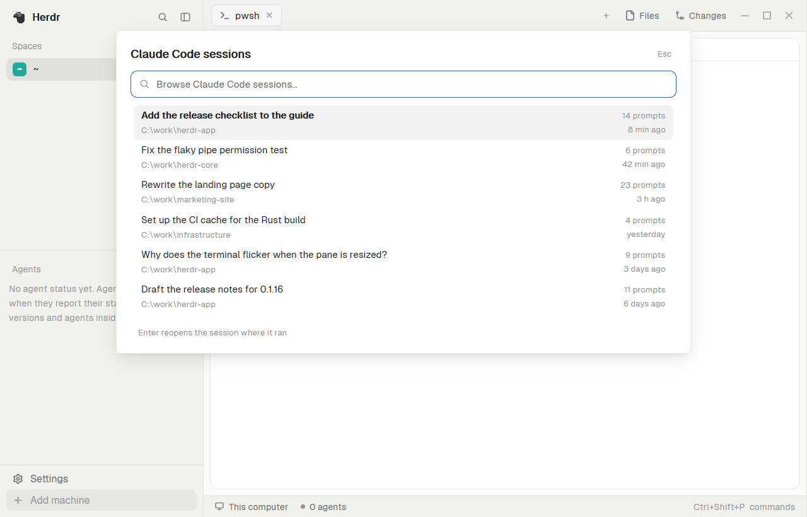

# Claude sessions

A popup over Herdr that lists the Claude Code sessions on this computer: every transcript Claude Code kept, newest first, each row with the session's title (its first prompt), the project folder it ran in, how many prompts it holds and when it was last used. Type in the field at the top to narrow the list by title, folder or session id, move with the arrow keys, and press Enter — or click the row — and that session opens again where it ran: in the space of the terminal that still carries it, else in the space of its project, else in a new space on this computer, running `claude --resume` with the session's id.

**Install:** tell your Herdr agent "Install the Herdr mod at
https://github.com/cifilaci/herdr-mods/tree/main/claude-sessions". It needs one key, and Herdr does
not ship it: the mod's own `keys.json` holds `"ctrl-shift-s": "mod.open:claude-sessions"` for the
`global` section — merge it into your own `~/.config/herdr-app/keys.json`, which is reloaded live,
so no restart is needed. It needs `claude` on the PATH and the Claude Code sessions already on this
machine. Before you install: the mod runs programs (`powershell` or `sh`) and reads files outside its
own folder — your whole Claude config (`~/.claude/projects` and `~/.claude/history.jsonl`). It does
not reach the network, and it writes nothing. What the agent does:

1. Copy the mod's own files — `main.js`, `mod.json` and `search.svg`, from
   `claude-sessions/mods/claude-sessions/` — into Herdr's mods folder
   (`~/.config/herdr-app/mods/` on Linux and macOS, `%USERPROFILE%\.config\herdr-app\mods\`
   on Windows), leaving `RECIPE.md` and `preview.png` out — they are the brief and the picture, not
   part of the mod — and run `herdr-app check ~/.config/herdr-app/mods/claude-sessions`.
2. Merge the mod's `keys.json` into your own `~/.config/herdr-app/keys.json`: the `global` section
   gets `"ctrl-shift-s": "mod.open:claude-sessions"`. Herdr rescans the mods folder on a timer, so
   the mod shows up within a few seconds — a restart is not needed. `ctrl-shift-s` opens the popup;
   nothing else does.

## What you see

A popup 760 px wide, its top edge 40 px below the top of the window, 80 % of the window's
height, on the theme's `popover` background with 18 px padding, 10 px gaps and 13 px base text.
Top to bottom:

- **Header row.** "Claude Code sessions" on the left, 15 px semibold, `foreground`. On the
  right an "Esc" chip: 11 px `dim` text, 6 px/2 px padding, 5 px corners; on hover it takes
  the `hover` background and `foreground` text. Clicking it closes the popup.
- **Search field.** 36 px tall, 9 px corners, a 1 px `accent` border, a `background` fill. A
  15 px magnifier (`search.svg`) in `dim` sits at the left, then the typed text at 12.8 px
  `foreground`; empty, the field shows the placeholder "Browse Claude Code sessions…".
- **The list.** One row per session, 46 px tall, 7 px corners, 10 px horizontal and 6 px
  vertical padding, 10 px between the two halves.
  - Left: the session title, 12.5 px `foreground`, cut with an ellipsis when it is long, and
    semibold while that row is the selected one. Under it the project folder, 11 px `dim`
    ("unknown folder" when there is none).
  - Right, aligned to the row's end: the prompt count and, under it, when the session was
    last used. Both 11 px `dim`. The count reads "3 prompts", or "1 prompt" for one; a session
    the history does not know shows no count at all. The time reads "just now", "12 min ago",
    "3 h ago", "yesterday", "6 days ago", or a date like "Nov 4".
  - The selected row and any row under the pointer take the `hover` background.
  - The list is at most 380 px tall; with more sessions than fit it scrolls, and the rows are
    then positioned by their own place in the list rather than by flow.
- **A line under the list.** 12 px `dim` while it is ordinary text: "Reading Claude Code's
  sessions…" while the listing runs, "No Claude Code sessions found in ~/.claude/projects"
  when there is nothing to show. With rows to show, the line reads "Enter reopens the session
  where it ran" at 11 px `dim`. A failure puts the error text in the `blocked` colour instead.

## How it behaves

- **Opening.** `ctrl-shift-s` opens the popup and the search field takes the keyboard
  straight away — and again 600 ms later, because the overlay is given the keyboard a beat
  after it opens.
- **What it lists.** The transcripts Claude Code wrote under its config root — `CLAUDE_CONFIG_DIR`
  when it is set, else `~/.claude` — in `projects/<project-slug>/<session-id>.jsonl`. Only the
  project's own transcripts are listed: what sits deeper belongs to sub-agents and workflows,
  and those cannot be resumed.
- **Titles, counts and last use** come from `~/.claude/history.jsonl`: the session's first
  prompt that is not a slash command, the number of prompts, the last time it was used and the
  project path. A session the history does not know gets one bounded head read of its
  transcript (the first 256 KiB) for a title and its folder. Its title then falls back to the
  first 8 characters of the session id.
- **The order** is newest first: by the later of the transcript's mtime and the history's last
  timestamp.
- **Typing narrows the list.** The filter matches the title, the folder or the session id,
  case-insensitively, and the selection goes back to the first row.
- **Keys.** `↑` and `↓` move the selection and wrap around the ends (the search field keeps the
  keyboard, so letters still type). `Enter` reopens the selected row. `Escape` closes the popup.
- **Clicking a row reopens it.** The popup closes first, then the session comes back.
- **Where it comes back to.** The space of the terminal that carries the session (a terminal
  with a `herdr.resume.*` label naming that session id), else the space whose folder is the
  session's project, else a new space on this computer. Either way the new tab runs
  `claude --resume <session-id>` in the session's folder; the tab is named after the title — or the
  first 8 characters of the session id when the history never gave it one — cut to 40 characters; a
  new space is named after the project folder's last segment.
- **Failures.** If the listing program cannot run, the error text is shown in the `blocked` colour
  and no rows are listed; the mod's own fallback reads `Error: Cannot list Claude Code's sessions`.

## Built from

- **Files.** `main.js` (the view and everything it reads), `mod.json`, `search.svg`. The mod
  folder holds nothing else.
- **`mod.json`**:
  `{ "place": "none", "title": "Claude sessions", "overlay": { "kind": "popup", "at": "top", "offset": 40, "width": 760, "height": 0.8 } }`
  The overlay block is where the size comes from — the view does not set it.
- **`main.js`** imports, each on one line:
  `import { View, div, svg } from "gpui-kit";`
  `import { v_flex, h_flex, InputState, Input } from "gpui-base";`
  `import { run, exec, theme, settings, props, closeOverlay, terminals, spaces, window } from "herdr";`
- **The herdr module it uses.** `run` (the two commands below), `exec` (the three programs),
  `theme` (every colour by name), `settings` (only `zoom`, to turn the measured pixel height
  of the list into the units the row maths uses), `props` (only `props().overlay`, handed to `closeOverlay` to close the
  popup), `terminals` (the labels that say which session a terminal carries, and that
  terminal's space), `spaces` (the space of a folder), `window` (only `platform`, to pick
  PowerShell or `sh`).
- **Commands.** `tab.new` — a new tab in the space the session came from:
  `run("tab.new", { space: space.id, name, folder: session.project, argv })`, where `argv` is
  `["claude", "--resume", session.id]` and `name` is the title cut to 40 characters. And
  `space.new` — the fallback, when no space holds the project:
  `run("space.new", { name: projectOf(session.project) || session.title, tab: name, folder: session.project, argv, machine: "" })`.
  The mod itself is opened with the app command `mod.open:claude-sessions`, and the key that reaches
  it is the one in the mod's own `keys.json`.
- **Programs it runs** (all through `exec`, each with a 120 s timeout):
  - The listing, one child process: on Windows `powershell -NoProfile -Command` with
    `Get-ChildItem -Path (Join-Path $root 'projects') -Filter '*.jsonl' -File -Recurse -Depth 1`;
    elsewhere `sh -c` with `for f in "$root"/projects/*/*.jsonl`. Each transcript is printed as
    path, mtime (unix seconds) and size, separated by NUL bytes.
  - The history, one child process: on Windows `powershell -NoProfile -Command` opening
    `history.jsonl` with a file handle and reading its last 4 MiB; elsewhere
    `sh -c 'tail -c 4194304 "$root/history.jsonl"'`.
  - The heads, one child process per 16 transcripts: on Windows `powershell -NoProfile -Command`
    with the paths inlined into the script; elsewhere `sh -c 'for p in "$@"'` with the paths as
    arguments. Each path is printed with its first 256 KiB, NUL separated.
- **Its constants.** `HEAD_BYTES = 262144`, `INDEX_BYTES = 4194304`, `CHUNK = 16`, `ROW = 46`.
- **Art.** `search.svg`: a 24 px magnifier (a circle at 11,11 with r 6.5 and the handle
  `m20 20-4-4`), `stroke="currentColor"`, `stroke-width="1.5"`, drawn at 15 px in `dim`.
- **Shipped things it leans on.** Herdr's own `mod.open` command — the key that reaches it is the
  one the mod's own `keys.json` carries; the terminal labels `herdr.space` and
  `herdr.resume.<agent>` that
  Herdr's terminals carry (the resume label is written by the agent's own hook, so a terminal
  that runs another agent never matches); `claude` on the PATH, which does the actual resume.

## Watch out

- **Herdr's rules for mods** (they are in the app's own guide,
  `~/.config/herdr-app/AGENTS.md`): never keep a `cx` and use it later — every callback gets
  its own; no `setTimeout`/`setInterval`, use `cx.timer`; no top-level `await`; every import on
  one line. This mod follows them, except that `load(cx)` keeps the `cx` from `init` for its
  final `cx.notify()` — a fresh build should take the `cx` from a `cx.spawn` callback instead.
- **`herdr-app check` runs the real programs.** The mod does not import `checking()`, and `init()`
  runs for real during a check, so the check reads the whole Claude config — the listing, the
  history tail and a head read per session the history does not know — and `exec` warns while it
  does. A fresh build should `import { checking } from "herdr"` and return early from `init()` when
  `checking()` is true.
- **A transcript runs to tens of megabytes. Never read one whole.** The listing is a shallow
  walk of the project folders, the history is read from its tail (4 MiB), and a transcript is
  only ever read as a 256 KiB head — 16 of them per child process.
- **The listing runs a real program, so its output is NUL separated**: path, mtime, size, three
  fields per transcript. Paths carry spaces and titles carry newlines, so a line-based split is
  wrong.
- **The Claude config root is `CLAUDE_CONFIG_DIR` when it is set, else `~/.claude`** — in all
  three scripts. The empty-list message still says `~/.claude/projects` even when the root is
  elsewhere.
- **Only the project's own transcripts are listed.** Deeper files under `projects/` belong to
  sub-agents and workflows and cannot be resumed, so they are left out.
- **The prompt count is the number of history entries for the session**, not the number of
  turns in the transcript. A session older than the last 4 MiB of the history has no count and no
  title: the head read fills in the title and the folder, but never the count, so such a row shows
  no "N prompts" at all.
- **The project can be a slug.** When neither the history nor the transcript head knows a path,
  the row shows Claude Code's mangled folder name (`-mnt-c-Users-Someone-Development-some-app`).
  That slug is then passed as the new space's `folder`, which is not a real path.
- **`machine: ""` means this computer.** Without it, `space.new` lands on the focused space's
  machine, and the session would be resumed on the wrong computer. It is the one argument
  that keeps a new space local.
- **What happens when the project has no space:** the mod opens a new space for it
  (`space.new`) with the project's folder, the tab named after the title and the space named
  after the folder's last segment, and the session resumes in a new terminal there. There is
  no prompt and no second space is offered.
- **The reopen looks at terminal labels:** any label whose key starts with `herdr.resume.` and
  whose JSON carries a `session_id` equal to the session's id. The terminal's `herdr.space`
  label then names the space. A terminal that never carried the session has no such label.
- **The mod answers no `nextCommand()`.** The only way in is `mod.open:claude-sessions`; a key
  bound to `claude-sessions.<anything>` does nothing.
- **The list is at most 380 px tall** and scrolls; when it does, the rows are absolutely
  placed and the selection is scrolled into view. A row is 46 px.
- **The title is the person's first prompt, cut to 160 characters.** A slash command (`/foo`),
  a `<command-name>` note and a `<local-command-…>` note are not titles, and a trailing
  "[Pasted text #1 …]" marker is cut off.
- **The popup's size lives in `mod.json`,** not in the view: 760 wide, `at: "top"` with a
  40 px offset, `height: 0.8`.
- **A mod's `mod.json` must exist before Herdr first sees the folder**, or Herdr docks a copy
  of the mod into the shown layout.
- **It reads files outside its own folder** — the whole Claude config — and runs `powershell`
  or `sh`. It writes nothing and it does not reach the network.

## Done when

- `herdr-app check ~/.config/herdr-app/mods/claude-sessions` passes.
- `ctrl-shift-s` opens a popup 760 px wide, its top edge 40 px below the top of the window,
  with the search field focused and the placeholder "Browse Claude Code sessions…".
- The list holds one row per transcript in `~/.claude/projects/*/*.jsonl`: the title, the
  project folder, "N prompts" and a relative time — and the newest session is the first row.
- A session the history has never seen shows the first 8 characters of its id as its title and
  no prompt count.
- Typing narrows the list by title, folder or session id; `↑` and `↓` move the selection (the
  selected row has the `hover` background and a semibold title) and wrap at the ends.
- `Enter` on a row — or a click on it — closes the popup and opens a tab named after the title
  that runs `claude --resume <session-id>` in the session's folder: in the space of the
  terminal that carries the session, else in the space whose folder matches, else in a new
  space on this computer.
- With `~/.claude/projects` empty the list reads "No Claude Code sessions found in
  ~/.claude/projects"; while the listing runs it reads "Reading Claude Code's sessions…".
- `Escape` closes the popup without opening anything, and the "Esc" chip does the same.
- With more sessions than fit, the list scrolls at 380 px and the selected row stays visible.
